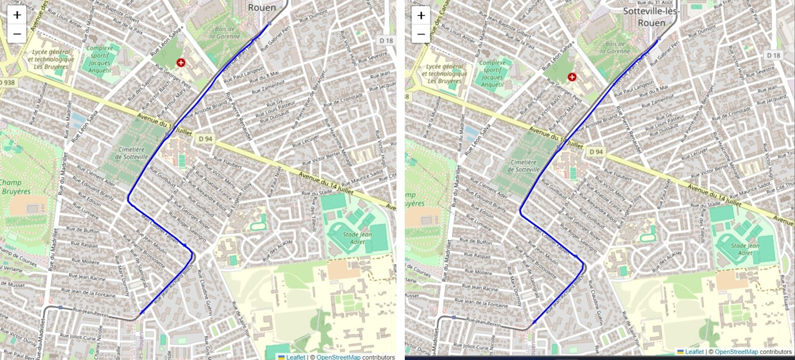
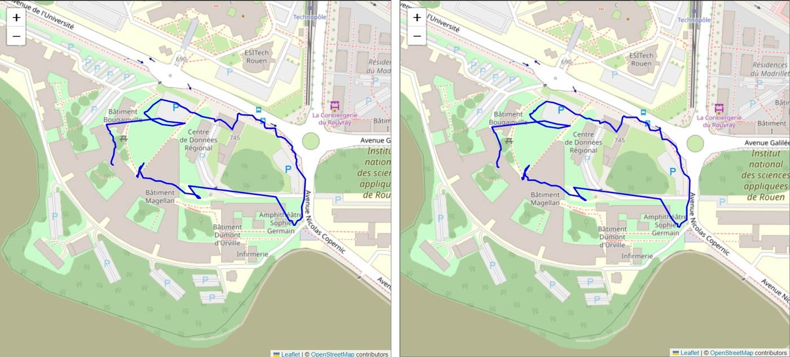
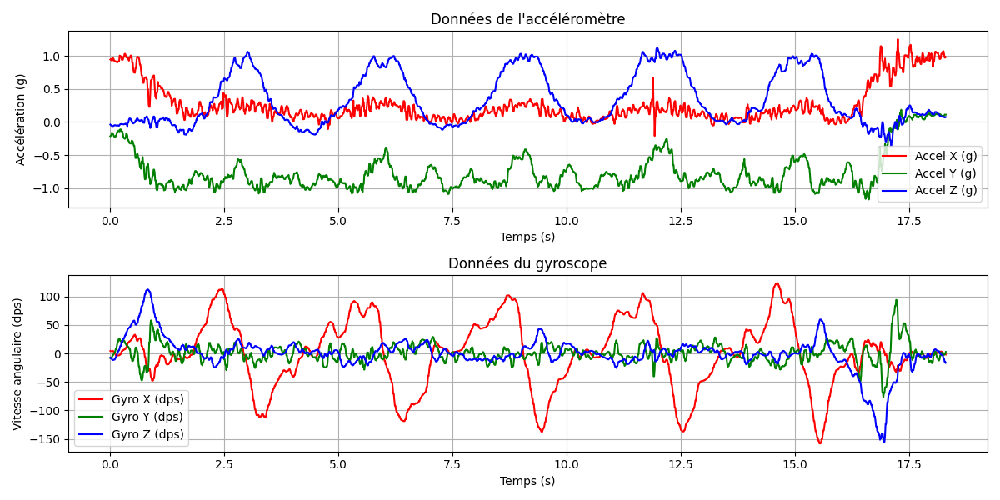

# ITInéraire — Suivi de trajectoire GPS + IMU sur Raspberry Pi

Boîtier de suivi de position, à la manière de Strava, construit autour d'une Raspberry Pi 4. Il enregistre les données d'un GPS et d'une centrale inertielle (IMU), puis les **fusionne avec un filtre de Kalman** pour estimer la trajectoire de la personne qui le porte.

Projet intégratif réalisé en équipe de 5 à l'INSA Rouen Normandie (ITI3, 2025-2026), en **Python**.



*Trajet en métro : position GPS brute (à gauche) et trajectoire estimée par le filtre de Kalman (à droite).*

---

## Fonctionnement

```
GPS (10 Hz) + IMU (52 Hz) ──> acquisition sur la Raspberry Pi ──> fichiers CSV
        ──> pré-traitement ──> filtre de Kalman ──> trajectoire estimée ──> carte (Folium)
```

1. **Acquisition.** La Raspberry Pi lit le GPS et l'IMU (accéléromètre, gyroscope, magnétomètre) sur le bus I²C, puis enregistre tout en CSV. Un bouton lance et arrête l'enregistrement, une LED indique qu'il est en cours et un écran LCD affiche la position.
2. **Pré-traitement.** Les mesures sont converties en unités physiques (m/s², rad/s), le biais du gyroscope est retiré, les lignes en double et les points GPS aberrants sont filtrés, et les coordonnées GPS sont projetées en mètres (x, y) autour du point de départ.
3. **Filtre de Kalman.** L'état estimé est `[x, y, vx, vy, θ]` : position, vitesse et cap.
   - **Prédiction** à chaque mesure de l'IMU : l'accélération est passée du repère du boîtier au repère du monde grâce au cap, puis intégrée.
   - **Correction** à chaque point GPS : la position GPS et le cap donné par le magnétomètre corrigent l'estimation. Chaque point GPS est associé à la mesure IMU la plus proche dans le temps.
4. **Visualisation.** La trajectoire estimée est reconvertie en latitude / longitude, puis affichée sur une carte interactive, à côté de la trace GPS brute.

---

## Résultats

- Quand le GPS capte bien (à pied, en métro, par temps couvert), la trajectoire filtrée est **plus lisse** que la trace brute et reste fidèle au trajet réel.
- Avec des **pertes de signal GPS** (passage dans les bâtiments de l'INSA pendant 10 minutes), le GPS produit des points aberrants. Le filtre améliore surtout les virages, mais il dépend encore beaucoup de la qualité du GPS.



**Pistes d'amélioration identifiées :**
- produire une position même pendant les pertes de GPS, en s'appuyant uniquement sur l'IMU ;
- régler les bruits du filtre (matrices Q et R) à partir des données mesurées ;
- ajouter d'autres capteurs pour dépendre moins du GPS.

---

## Fonctionnalité bonus : compteur de squats

L'équipe a aussi développé un compteur automatique de squats à partir des données de l'IMU (filtrage du signal, puis détection des pics), avec une petite page web qui affiche le compteur. Sur 5 sessions de test (21 squats réels), il en a détecté 19 sans aucune fausse détection.



---

## Matériel

| Composant | Rôle |
|---|---|
| Raspberry Pi 4 | Acquisition et stockage des données |
| GNSS DFRobot TEL0157 | Position par satellites (GPS, BeiDou, GLONASS) |
| IMU Pololu MinIMU-9 v6 | Accéléromètre, gyroscope, magnétomètre |
| Écran LCD, LED, bouton | Interface de l'acquisition |

---

## Technologies

- **Python** : NumPy, Pandas, SciPy, Matplotlib, Folium
- **Filtre de Kalman** (modèle à vitesse constante, entrée accélération), changement de repère, projection GPS → plan
- **Raspberry Pi** : bus I²C (`smbus`), GPIO, multithreading pour l'acquisition
- **Bash** pour enchaîner les traitements

---

## Lancer le post-traitement

Le post-traitement tourne sur n'importe quel PC. Une vraie acquisition faite en métro est fournie dans `data/exemple_metro/` pour l'essayer directement.

```bash
pip install -r requirements.txt
cd code/postprocessing

# 1) Filtre de Kalman (quelques secondes)
./kalman.sh ../../data/exemple_metro timestamps_imu.csv timestamps_coords.csv

# 2) Cartes avant / après le filtre
./plot_gnss.sh ../../data/exemple_metro
```

Les résultats sont créés dans `data/exemple_metro/` :
- `resultats_kalman/traj_estimee.csv` : trajectoire estimée par le filtre ;
- `cartes_gnss/carte_avant_kalman.html` et `carte_apres_kalman.html` : cartes interactives à ouvrir dans un navigateur.

Pour analyser une acquisition de squats (placée dans `code/data/<dossier>/timestamps_squat.csv`) :

```bash
./code/postprocessing/squat/process_show_squat.sh <dossier>
```

L'acquisition sur la Raspberry Pi se lance avec `code/scripts/capture_gnss_imu.py`, et les bibliothèques Raspberry Pi indiquées en commentaire dans `requirements.txt` doivent alors être installées.

---

## Organisation du dépôt

```
code/
├── config/            Paramètres des capteurs (fréquences, plages, adresses I²C)
├── sensors/           Pilotes du GNSS et de l'IMU
├── core/              Acquisition GNSS et IMU
├── scripts/           Scripts d'acquisition lancés sur la Raspberry Pi
├── postprocessing/    Pré-traitement, filtre de Kalman, cartes, compteur de squats
├── serveur_web/       Page web du compteur de squats
└── utils/             LCD, LED, bouton, écriture CSV
data/exemple_metro/    Exemple d'acquisition réelle (GPS + IMU) pour tester le filtre
docs/                  Rapport (PDF) et images
```

📄 Le rapport complet est dans [`docs/rapport.pdf`](docs/rapport.pdf).

---

## Ma contribution

Au sein du groupe chargé du suivi de trajectoire :
- **Filtre de Kalman** : conception et implémentation de la fusion GPS + IMU (modèle d'état, prédiction à partir de l'accélération, correction par le GPS et le magnétomètre).
- **Acquisitions** sur le terrain (trajets à pied, en métro, avec pertes de signal).
- **Rédaction** du rapport.

Lors de la mise en ligne, j'ai aussi rendu le filtre environ 20 fois plus rapide (association GPS ↔ IMU par recherche dichotomique, résultats identiques) et corrigé une incohérence de rayon terrestre dans la conversion des coordonnées.

---

## Équipe

Projet réalisé par Hadi Assi, Yann Grondin, Maximilien Lesterlin, Benoît Rolla et Nicolas Yvanoff.
